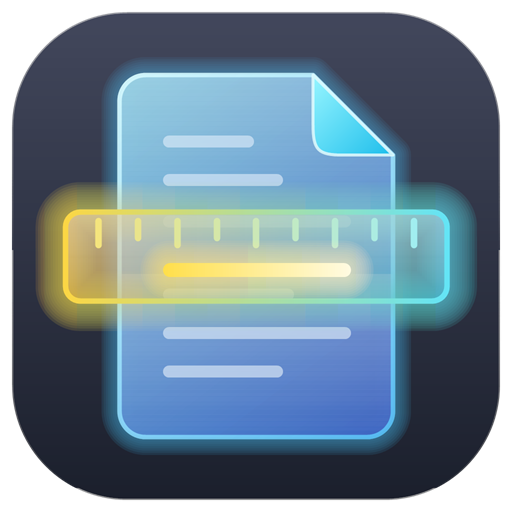
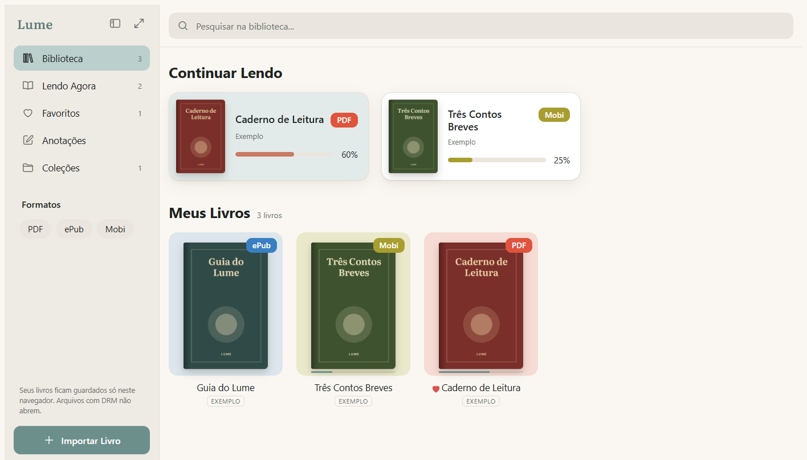
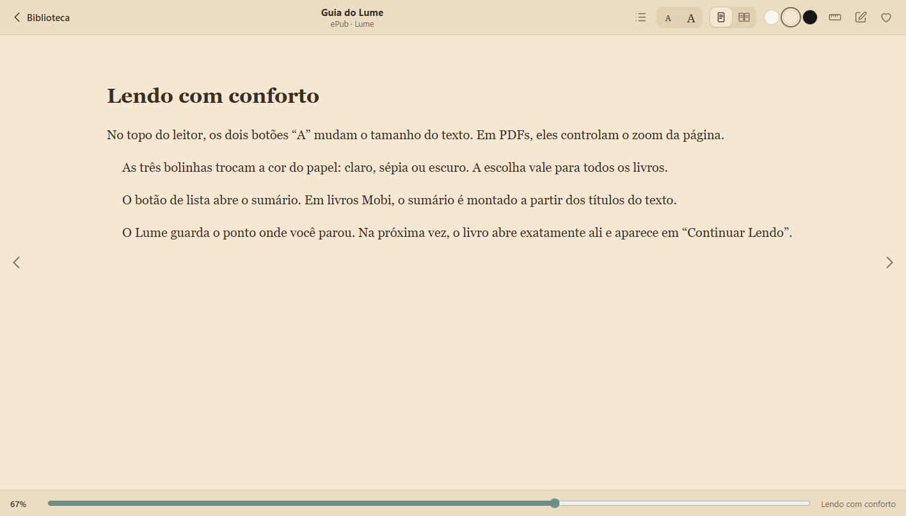
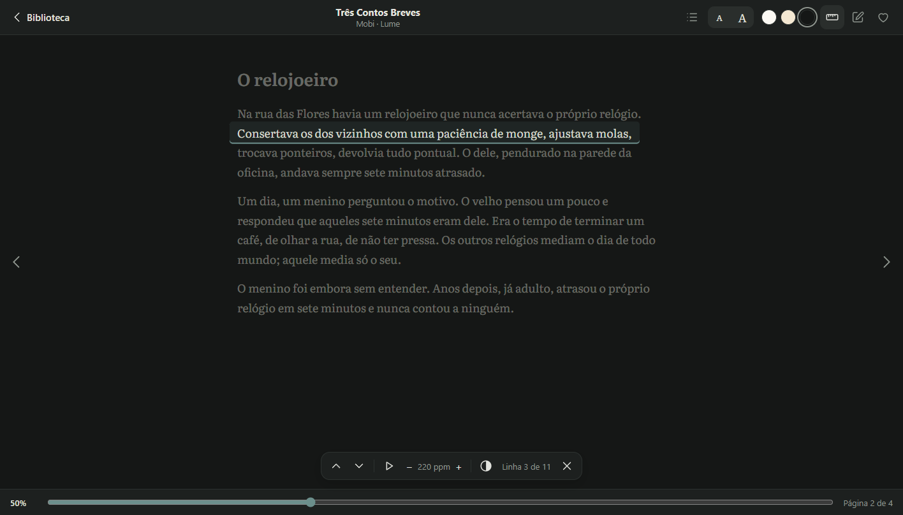
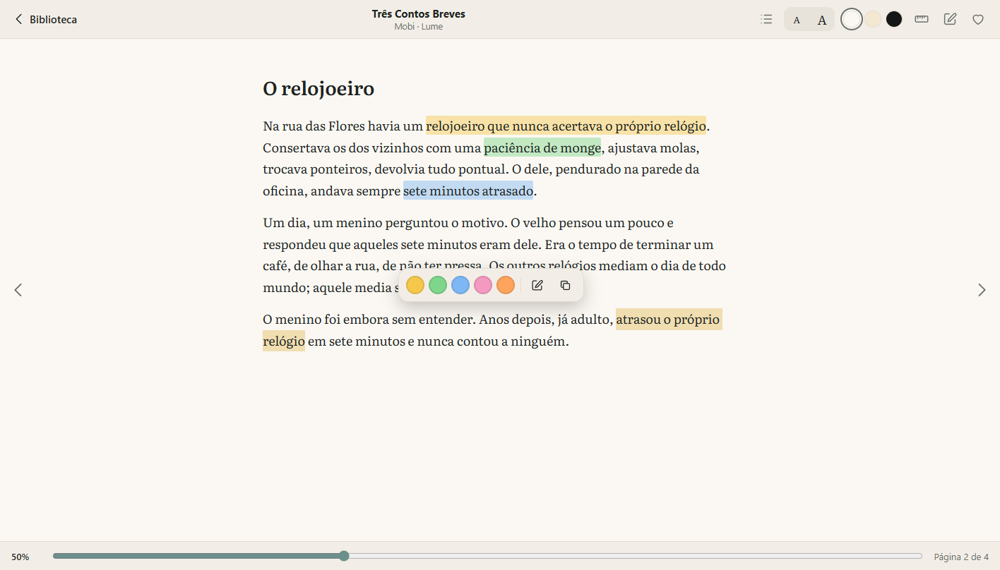

<p align="center">
  
</p>

# LUME — v1.4

Leitor de **PDF, ePub e Mobi** para Windows, com biblioteca, régua de leitura, marcação de texto em cores e anotações. Seus livros e o ponto onde você parou ficam salvos no seu próprio computador.

> **Download oficial:** baixe apenas pela página de [Releases](https://github.com/OliverQueenw/Lume/releases/latest). Rode o `Instalar-Lume.exe`; não é preciso ser administrador.
>
> **Aviso do Windows:** o instalador ainda não tem assinatura digital, então o SmartScreen pode mostrar "O Windows protegeu o computador". Clique em **Mais informações → Executar assim mesmo**.



## Novidades da v1.4

- **Discord Rich Presence** — ao abrir um livro, seu perfil no Discord mostra **Lendo**, o autor e o título (sem a capa). O cartão some quando você fecha o livro, e a opção "Mostrar no Discord o livro que estou lendo", na barra lateral, liga e desliga na hora.

## Novidades da v1.3

- **Janela própria** — o Lume não abre mais o navegador: roda na própria janela, com o componente WebView2 do Windows. Só aparecem os menus do Lume.
- **Marcação de texto em cores** — selecione um trecho e escolha entre amarelo, verde, azul, rosa e laranja. Clique numa marcação para trocar a cor ou remover.
- **PDF com texto selecionável** — dá para selecionar, copiar e marcar trechos de PDFs (exceto PDFs escaneados).
- **Opacidade da régua** — escolha o quanto o resto do texto escurece enquanto a régua está ligada.
- **Uma ou duas páginas no ePub** — leia em uma coluna ou com duas páginas lado a lado, como um livro aberto.

## O que o Lume faz

- **Biblioteca** — capas, "Continuar Lendo" com o progresso de cada livro, busca, filtro por formato, favoritos e coleções.
- **Três formatos** — PDF (com pdf.js), ePub (com epub.js) e Mobi (leitor próprio, escrito do zero, que extrai texto, capa e imagens).
- **Leitura confortável** — tamanho do texto, papel claro, sépia ou escuro, sumário e tela cheia. O Lume lembra a página onde você parou.
- **Régua de leitura** — destaca a linha que você está lendo e escurece o resto. A seta ↓ desce uma linha e vira a página sozinha no fim; ↑ volta. Tem modo automático com velocidade em palavras por minuto.
- **Marcações e anotações** — trechos marcados e comentários ficam juntos na tela **Anotações**, com a cor de cada marcação. Clique numa anotação para voltar ao trecho.
- **Discord** — mostra no seu perfil o livro que você está lendo (pode ser desligado).
- **Seus arquivos no seu PC** — tudo fica em `Documentos\Lume`, como arquivos comuns. Seus livros e anotações não são enviados para a internet.
- **Funciona offline** — as bibliotecas de leitura vêm dentro do programa.

<table>
  <tr>
    <td></td>
    <td></td>
  </tr>
  <tr>
    <td align="center">Leitor de ePub, papel sépia</td>
    <td align="center">Régua de leitura, tema escuro</td>
  </tr>
</table>



## Atalhos

| Tecla | O que faz |
|---|---|
| → ou Page Down | Próxima página |
| ← ou Page Up | Página anterior |
| ↓ | Liga a régua / desce uma linha |
| ↑ | Sobe uma linha da régua |
| Esc | Fecha a barra de marcação, a régua ou o livro |

## Onde ficam os arquivos

- `Documentos\Lume\Livros` — os PDF, ePub e Mobi importados (uma cópia; o original continua onde estava).
- `Documentos\Lume\dados\livros` — título, capa, página onde você parou, favoritos e coleção de cada livro.
- `Documentos\Lume\dados\anotacoes` — anotações e marcações.

Para remover um livro, use o menu **⋯** do livro dentro do Lume.

## Requisitos

- Windows 10 ou 11, 64 bits.
- Microsoft WebView2 Runtime — já vem no Windows 10 e 11. Se faltar, o instalador avisa e abre a página oficial da Microsoft.

## Como compilar

O Lume é compilado com o compilador C# do .NET Framework 4, que já vem no Windows. Não é preciso instalar o Visual Studio.

```powershell
git clone https://github.com/OliverQueenw/Lume.git
cd Lume
powershell -ExecutionPolicy Bypass -File build.ps1
```

O resultado fica em `dist\`: o `Lume.exe` (com os três arquivos `.dll` do WebView2, que precisam ficar ao lado dele) e o `Instalar-Lume.exe`. Na primeira compilação o script baixa o pdf.js, o epub.js, o JSZip e o kit do WebView2 (pacote oficial da Microsoft no NuGet).

### Estrutura do código

- `lume.html` — interface e leitores (HTML, CSS e JavaScript).
- `Lume.cs` — a janela (WebView2) e o servidor local que salva tudo em `Documentos\Lume`.
- `Instalador.cs` — instalador e desinstalador (instala só para o usuário atual, em `AppData\Local\Programs\Lume`).
- `build.ps1` — gera o programa e o instalador.
- `icon.ps1` — desenha o ícone a partir de código.

## Base utilizada

- [pdf.js](https://github.com/mozilla/pdf.js) — Mozilla, licença Apache 2.0.
- [epub.js](https://github.com/futurepress/epub.js) — licença BSD 2-Clause.
- [JSZip](https://github.com/Stuk/jszip) — licença MIT.
- [Microsoft WebView2](https://developer.microsoft.com/microsoft-edge/webview2/) — SDK da Microsoft, redistribuído junto com o programa.
- Fonte [Literata](https://fonts.google.com/specimen/Literata) — SIL Open Font License.

## Observações

- Livros com DRM (por exemplo, comprados na Amazon) não abrem.
- Mobi com compressão HUFF/CDIC e AZW3 (KF8) ainda não são suportados.
- Em PDFs escaneados (só imagem), a régua e a marcação não encontram texto.
- O cartão do Discord só aparece com o aplicativo do Discord aberto no computador e com a opção **Privacidade de atividades → Compartilhar minha atividade detectada** ligada.
- Alguns antivírus podem desconfiar de programas novos sem assinatura digital. O código está todo aqui para quem quiser conferir.

## Já feito

- ✔ Biblioteca com capas, progresso, busca, favoritos e coleções
- ✔ Leitores de PDF, ePub e Mobi
- ✔ Régua de leitura com detecção de linhas, modo automático e opacidade ajustável
- ✔ Marcação de texto em cinco cores e anotações
- ✔ Uma ou duas páginas no ePub
- ✔ Programa para Windows com janela própria e instalador
- ✔ Discord Rich Presence (Lendo / autor / título)
- ✔ Funciona sem internet

## Próximas ideias

- Busca dentro do livro
- Exportar anotações e marcações
- Suporte a AZW3 (KF8)
- Leitura em voz alta
- Instalador com assinatura digital

## Licença

MIT — veja o arquivo [LICENSE](LICENSE).
